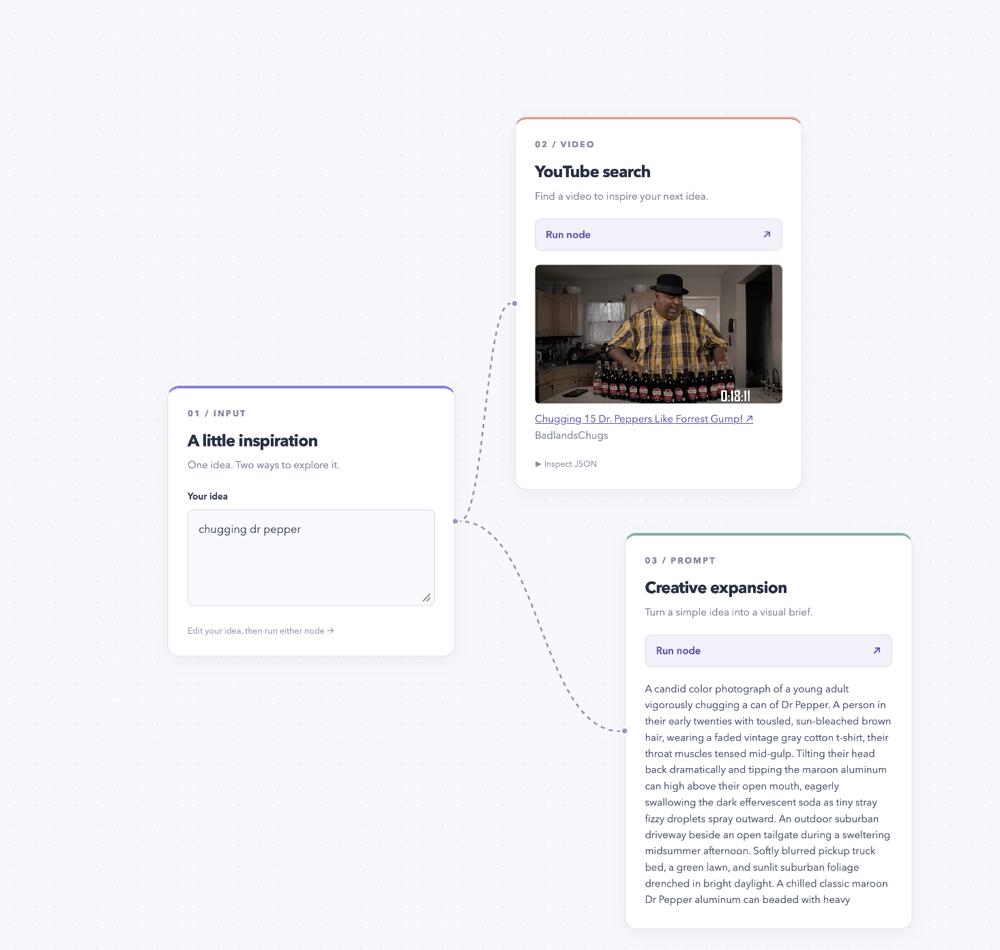

# HexNode

Backend nodes for YouTube search and creative prompt expansion with Gemini.



| Node | Input | Output |
|---|---|---|
| YouTube | Search text | JSON containing video metadata and links, or `{ "video": null }`. |
| Prompt Creative Expansion | An idea and Auto or manual controls | JSON containing `{ text, fields }`. |

## Setup

Use **Node.js 22.18 or newer**. Run all commands from the project root.

Copy the configuration template:

```sh
cp -n .env.example .env
```

```env
YOUTUBE_API_KEY=your_youtube_api_key
GOOGLE_APPLICATION_CREDENTIALS=./credentials/service-account.json
GOOGLE_CLOUD_LOCATION=global
GEMINI_MODEL=gemini-3.8-flash
```

- **YouTube:** enable YouTube Data API v3 for your API key's project.
- **Prompt Creative Expansion:** place your full service-account JSON in `credentials/service-account.json`. Enable billing and the Vertex AI API, and grant the service account `roles/aiplatform.user` on the project.

Each node needs only its own credentials. `.env` and `credentials/` are ignored by Git.

## YouTube search

```sh
node --env-file=.env src/cli/youtube.ts "cinematic mountain footage"
```

Returns the first matching embeddable video's ID, title, description, channel,
thumbnail URL, watch URL, and embed URL inside `video`. If nothing matches,
`video` is `null`.

Display the returned embed URL in an iframe inside your React graph.

## Prompt Creative Expansion

```sh
node --env-file=.env src/cli/prompt-creative-expansion.ts "a robot selling flowers"
```

Gemini develops the idea into a detailed visual brief. It can add appearance,
props, surroundings, lighting, textures, and mood while preserving the core idea
and explicit requirements. It generates prompt text, not an image.

### Optional settings

```sh
node --env-file=.env src/cli/prompt-creative-expansion.ts "a robot selling flowers" \
  --background "A modern train platform" \
  --lighting "Overcast daylight" \
  --blur 73
```

Each control has two sources:

- **Auto:** omit it, or pass `--lighting auto` (also works for other controls).
- **Manual:** use a slider value for blur, or text/presets for the other controls.

| Control | Manual option | Purpose |
|---|---|---|
| Background | `--background "Train platform"` | Background objects, scenery, and layout. |
| Framing | `--framing "Close-up"` | Shot size, viewpoint, and subject placement. |
| Lighting | `--lighting "Soft daylight"` | Direction, softness, warmth, and contrast. |
| Style | `--style "Watercolor"` | Medium, palette, texture, and rendering. |
| Blur | `--blur 73` | Subject sharpness and background visibility. |

**Blur scale:** `0` means a sharp subject and background; `50` means a sharp
subject with a soft but recognizable background; `100` means a sharp subject
against indistinct background shapes. These values guide wording, not a measured
blur effect in the final image.

### JSON output

The CLI always prints JSON. No output-format flag is needed.

| Item | Meaning |
|---|---|
| `text` | Complete prompt to send to an image model. |
| `fields` | Individual prompt details to save or edit in a graph. |

The `fields` object contains:

| Field | Meaning |
|---|---|
| `subject` | Main person, creature, object, or scene. |
| `appearance` | Subject's physical features and materials. |
| `action` | What the subject is doing. |
| `setting` | Overall location, time, or atmosphere. |
| `background` | Objects and scenery behind the subject. |
| `props` | Supporting objects in the scene. |
| `framing` | Shot size, viewpoint, and lens direction. |
| `focus` | Subject sharpness and background blur in words. |
| `lighting` | Light source, direction, and softness. |
| `style` | Visual medium, color treatment, and rendering style. |
| `textures` | Visible surface details. |
| `mood` | Emotional atmosphere. |
| `constraints` | Array of requirements and exclusions. |

Inapplicable fields are `null`; no constraints is `[]`.
Errors print to stderr and exit with a nonzero status.


# API_I
